  

# ⚡ Awesome JavaScript Runtimes

  
  
  
  
  
  

## 🚀 Top JavaScript Runtimes & Serverless Compute Ecosystem

> A curated discovery index of leading **SaaS platforms**, **serverless cloud engines**, and **open-source JavaScript runtimes** designed for high-performance server-side execution, edge computing, isolate sandboxing, and embedded IoT environments.

**Last updated: October 2026** 📅

This repository tracks battle-tested **SaaS developer platforms** and high-velocity **open-source projects** for modern **JavaScript and TypeScript execution**. Outside browser environments, these engines power backend web APIs, microservices, CLIs, edge workers, and distributed microVMs—with distinct tradeoffs in start-up latency (cold starts), V8 isolate sandboxing, memory footprints, and Node.js API compatibility.

---

## 📑 Table of Contents

- [🌐 Sector Overview & Market Dynamics](#-sector-overview--market-dynamics)
- [☁️ SaaS & Hosted Compute Platforms](#️-saas--hosted-compute-platforms)
- [🛠️ Open-Source JavaScript Runtimes](#️-open-source-javascript-runtimes)
- [📈 Star History](#-star-history)
- [🤝 Support & Sponsorship](#-support--sponsorship)
- [💡 How to Contribute](#-how-to-contribute)
- [⚠️ Disclaimer](#️-disclaimer)

---

## 🌐 Sector Overview & Market Dynamics

The cloud-managed JavaScript runtime and serverless compute market is estimated at **$18.5 Billion in 2026** (growing at an estimated 22.8% CAGR as part of the broader serverless and edge computing sector). The industry exhibits **moderate fragmentation with high concentration at the foundational cloud tier**; hyperscalers (Amazon AWS and Google Cloud) dominate core infrastructure spend, while specialized developer-centric clouds (Vercel, Cloudflare, and Render) capture the high-margin developer-experience (DX) and edge runtime layers through specialized V8 isolate architectures and automated CI/CD workflows.

---

## ☁️ SaaS & Hosted Compute Platforms

The table below lists top managed serverless, edge, and containerized platforms providing native JavaScript and TypeScript runtime environments. Sorted by company scale (Revenue / Valuation in descending order).

| Platform | Company Valuation / Revenue | Starting Tier Pricing | Free Tier / Trial Limits | Key Architecture & Ideal Use Case |
| :--- | :--- | :--- | :--- | :--- |
| **[AWS Lambda](https://aws.amazon.com/lambda/)** ⚡ | ~$2.25 Trillion Mkt Cap (Amazon) / ~$105B AWS Run-Rate | $0.20 per 1M requests + $0.0000166667 per GB-second | **1 Million free requests/month** & 3.2M seconds of compute time (400,000 GB-seconds) forever | Official Node.js runtime with provisioned concurrency and ARM Graviton support. Industry-standard for event-driven cloud architectures. |
| **[Google Cloud Run](https://cloud.google.com/run)** 🏃 | ~$2.10 Trillion Mkt Cap (Alphabet) / ~$42B GCP Run-Rate | $0.40 per 1M requests (beyond free quota) + $0.00002400 per vCPU-sec & $0.00000250 per GiB-sec | **2 Million free requests/month**, 360,000 vCPU-seconds, 180,000 GiB-seconds compute, and 1 GiB outbound egress/month | Fully managed containerized platform running any Node.js/Bun web server with automated zero-to-N scaling. |
| **[Cloudflare Workers](https://workers.cloudflare.com/)** 🌍 | ~$34 Billion Mkt Cap (NYSE: NET) / ~$1.7B Revenue | Workers Paid starting at $5/month (includes 10M requests + $0.50/M additional requests) | **100,000 requests/day** forever (10ms CPU time limit per request, unlimited burst bandwidth) | V8 isolate architecture with near-zero cold starts (<5ms) deployed across 300+ global edge locations. |
| **[Vercel](https://vercel.com/)** ▲ | $9.3 Billion Valuation (Series F) | Pro Plan at $20/user/month (includes $20 compute credits and 1TB bandwidth) | **Hobby Plan Free Forever**: 100 GB bandwidth/month, 1M Edge function invocations, 100,000 serverless execution seconds | Optimized frontend cloud with Serverless & Edge functions tailored for Next.js, SvelteKit, and Nuxt apps. |
| **[Render](https://render.com/)** 🚀 | $1.5 Billion Valuation (Series B) | Individual instances from $7/month; Team workspace starts at $19/user/month | **Free Web Services Forever**: 750 free instance hours/month (512MB RAM, shared CPU; spins down after 15m inactivity) | Zero-DevOps cloud for Node.js apps, background workers, and PostgreSQL with automatic continuous Git deployments. |
| **[Fly.io](https://fly.io/)** 🪂 | $1.1 Billion Valuation (Series C) | Pay-as-you-go microVMs starting from $1.94/month per shared-cpu-1x (256MB RAM) | **$5/month free credit allowance** (free forever allowance covering up to 3 shared-cpu-1x microVMs and 3GB persistent storage volumes) | Hardware-virtualized Firecracker microVMs executing JavaScript apps globally near end-users with Anycast routing. |
| **[Railway](https://railway.app/)** 🚂 | ~$250 Million Valuation | Hobby Plan starting at $5/month base fee + usage ($0.000231/GB-hr RAM, $0.000463/vCPU-hr) | **30-day Free Trial with $5 one-time execution credit** and 512MB RAM cap without requiring credit card upfront | Git-driven PaaS with instant template deployments and infrastructure-as-code via `railway.json`. |
| **[Deno Deploy](https://deno.com/deploy)** 🦕 | ~$150 Million Valuation (Deno Land Inc.) | Pro Plan starting at $10/month (includes 5M requests + $2/month per additional million) | **100,000 requests/day free forever** (maximum 512MB memory per isolate, up to 100 deployed projects) | Native Deno/TypeScript edge compute platform with globally distributed V8 isolates and zero build steps. |

---

## 🛠️ Open-Source JavaScript Runtimes

The top open-source JavaScript runtimes and execution engines for servers, microservices, edge sandboxing, WebAssembly, and IoT. Sorted by **GitHub Star Counts** in descending order.

| Project & Repository | GitHub Stars | Core Engine / Architecture | Primary Strengths & Deployment Scenarios |
| :--- | :--- | :--- | :--- |
| **[Node.js](https://github.com/nodejs/node)** 🟢 |  | Google V8 / libuv (C++) | **The enterprise standard.** Massive npm registry, stable LTS cycles, native TypeScript type stripping (v22+), and unbeatable ecosystem compatibility for mission-critical production servers. |
| **[Deno](https://github.com/denoland/deno)** 🦕 |  | Google V8 / Tokio (Rust) | **Security-first runtime.** Explicit flag-based permission model (filesystem/network sandbox), native TypeScript and JSX execution, built-in standard library, and transparent `npm:` package compatibility. |
| **[Bun](https://github.com/oven-sh/bun)** 🧅 |  | JavaScriptCore (WebKit) / Zig | **Ultra-fast all-in-one toolkit.** 3x–10x faster startup, built-in bundler, transpiler, test runner, and npm-compatible package manager with minimal overhead. |
| **[V8](https://github.com/v8/v8)** ⚙️ |  | Google V8 (C++) | Google's open-source high-performance JavaScript and WebAssembly engine used in Chrome, Node.js, Deno, and Cloudflare workerd. |
| **[Hermes](https://github.com/facebook/hermes)** 📱 |  | Hermes Bytecode Engine (C++) | Meta's lightweight JavaScript engine optimized for running React Native apps, fast TTI (Time to Interactive), and low memory footprint on mobile/embedded targets. |
| **[QuickJS](https://github.com/bellard/quickjs)** ⚡ |  | QuickJS Engine (C) | Fabrice Bellard's ultra-compact, embeddable ES2023 engine that compiles JS to native C binaries with near-zero binary footprint (~210 KiB). |
| **[WasmEdge](https://github.com/WasmEdge/WasmEdge)** 🕸️ |  | WebAssembly / LLVM (C++/Rust) | CNCF sandbox WebAssembly runtime supporting lightweight, sandboxed JavaScript execution across edge devices, serverless, and Kubernetes plugins. |
| **[workerd](https://github.com/cloudflare/workerd)** 🛡️ |  | Cloudflare V8 Isolates (C++) | The open-source V8-based core powering Cloudflare Workers. Eliminates container virtualization overhead with multi-tenant sub-millisecond sandboxes. |
| **[LLRT (Low Latency Runtime)](https://github.com/awslabs/llrt)** ⚡ |  | QuickJS / Rust | Amazon's experimental serverless runtime delivering up to 10x faster cold starts and 2x lower memory consumption compared to standard Node.js on AWS Lambda. |
| **[JerryScript](https://github.com/jerryscript-project/jerryscript)** 📟 |  | JerryScript Engine (C) | Ultra-lightweight JavaScript engine created for the Internet of Things (IoT), capable of executing on microcontrollers with less than 64KB RAM. |
| **[QuickJS-NG](https://github.com/quickjs-ng/quickjs)** 🔬 |  | QuickJS Modern Fork (C) | Next-generation community fork of QuickJS with updated TC39 proposals, WebAssembly support, CMake integration, and robust bugfixes. |
| **[txiki.js](https://github.com/saghul/txiki.js)** 📦 |  | QuickJS / libuv (C) | Tiny, fast JavaScript runtime combining QuickJS with libuv for event loop I/O and WHATWG Web Platform APIs (`fetch`, `WebSocket`, `Worker`). |

---

## 📈 Star History

---

## 🤝 Support & Sponsorship

If you find **Awesome JavaScript Runtimes** valuable for your projects, research, or benchmarking:

- ⭐ **Star this repository** on GitHub to help other engineers discover it.
- 🍴 **Fork the repo** to contribute new engines and benchmarks.
- 📢 **Share with your team** and tech network on X / LinkedIn / Discord.
- ☕ **Support development & maintenance**: Buy a coffee via the [GitHub Sponsor Dashboard](https://github.com/sponsors/ishandutta2007).

Your sponsorship helps keep these ecosystem indexes comprehensive, benchmarked, and up to date! ❤️

---

## 💡 How to Contribute

We welcome additions, corrections, and benchmark refinements! 

1. **Fork** the repository.
2. **Add/Edit** entries in `README.md` adhering to the tabular format and detail guidelines.
3. Verify that **exact pricing tiers**, **free tier quotas**, and **official GitHub repositories** are linked.
4. **Submit a Pull Request** with a brief rationale explaining the project's relevance.

---

## ⚠️ Disclaimer

- This list is community-maintained for informational and architectural evaluation purposes.
- Runtime performance benchmarks vary significantly across payload sizes, concurrency levels, hardware architectures, and underlying framework layers.
- Check vendor documentation regularly as SaaS pricing models, free tiers, and cloud limits frequently evolve.

---

  Part of the <a href="https://github.com/ishandutta2007/Awesome-Awesome-Awesome">Awesome-Awesome-Awesome</a> collection. Maintained with care by backend developers for the open-source engineering community.

